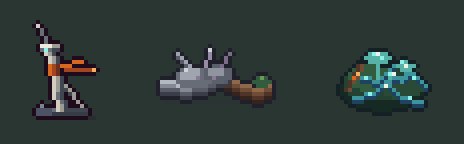
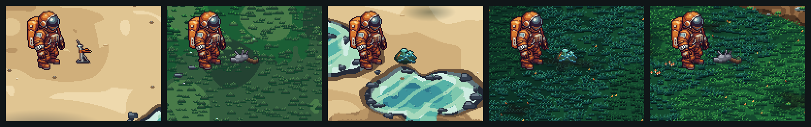

# VERDANT SIGNAL — V11.0: THE ART OF IMMERSION Report

**Branch:** `arena/1d52d1b9-2-5-game` (`main` untouched at `cfad6b8`)  
**Pre-V11.0 Recoverable Checkpoint:** `1794a48` (local Git tag `v10.0-pre-v11-checkpoint`)  
**Target Engine & Hardware:** Godot `4.7.2` GL Compatibility (`640×360` integer viewport, MSAA/HDR off, float-only shaders) targeting Windows / Intel HD Graphics 3000  

---

## 1. Initial State Audit

Before modifying any file, the full V10.0 production baseline (`1794a48`) was audited across scenes, scripts, audio buses, lore documents (`docs/concept/04-story-and-narrative-foundation.md`, `10-scientific-exploration-and-discovery.md`, `15-audio-direction.md`), ecosystem JSON data, V10.0 Pass 2 visual renders, and automated validation tests (`8/8` suites, `38/38` tests).

- **Strengths Preserved:** Unified `2304×2880` seamless Broken Shore (`y=1344..2880`) + Living Forest (`y=0..1536`) world, deterministic `3×3` `WorldChunkStreamer`, unmodified `88×88` Mara sprite sheets (`SHA-256` prefix `3f1af238...`), pixel-matched northern ecotone seam, 5-tier `AudioBusLayout` (`Master`, `Music`, `Ambient`, `SFX`, `CaveReverb`), 66 coastal props, 1,037 coastal grass tufts, 14 coastal fauna, 7 woodland critters, breached *ICV Meridian* interior cutaway, and all V8.0/V9.0/V10.0 assets and editable `.vpf.json` sources.

---

## 2. Five Prioritized Grounded Weaknesses (Gameplay Experience Audit)

1. **Debug-First HUD Obscuring ~25% of the `640×360` Viewport & Silencing Discovery When Hidden**  
   `PrototypeHud` defaulted to showing developer telemetry (`FPS`, `CHUNK`, `TUFTS`, asset banner, full keybind strip). Hiding it with `F3` also hid `_telemetry_label`, which was the *only* place Acoustic Field Lens (`[Q]`) and Field Sample (`[E]`) results ever printed. Players had no contextual proximity prompt, no region arrival whisper, no clean field observation card, and no way to review collected discoveries or Mara's evolving working hypothesis (`open_field_codex` / `KEY_TAB` was already bound in `project.godot` but completely unwired).
2. **Authored Ecological Storytelling Unused + Weak `[Q]`/`[E]` World Feedback**  
   Authored `detail` strings inside `broken_shore_ecosystem_data.json` were never shown to the player. Holding `[Q]` spawned only a single `32×32` ring at Mara's feet, while pressing `[E]` gave zero visual or audio feedback and used inconsistent detection radii across sites (`115 px`, `128 px`, `175 px`).
3. **Quiet Off-Path Corners & Missing Subtle Cross-Biome Mystery Threads**  
   Several walkable off-path areas (Zone D western basalt lee, Zone E western scrub, far-east tidepool surge edge, and the NW/SW Living Forest groves) offered little reason to stray off the central path, and there were no subtle pre-arrival *Surveyor-01* or creeping metallic-blight traces linking coast and canopy without spoiling Act 3–4 secrets.
4. **Under-Reactive Wildlife/Flora & Unused Crouch-Stealth (`C`) Mechanic**  
   `PlayerController` already tracked `is_crouching` (`C`) and `is_scanning` (`Q`/RMB), yet Living Forest butterflies/moths ignored Mara's movement or scanning, Mirror-Shell Crabs fled at identical radii whether Mara sprinted or crouched, Chime-Wing Gliders ignored `[Q]` acoustic pulses, Amber Tide-Kelp didn't brighten when waded through or scanned, and embedded `FloraProp` bushes didn't rustle when Mara brushed past them.
5. **Unused `CaveReverb` Bus & Missing Acoustic Differentiation**  
   `game/audio/default_bus_layout.tres` already configured an authentic `CaveReverb` bus (`AudioEffectReverb`), but nothing routed to it. Stepping onto the breached *ICV Meridian* hull grating still played beach sand footsteps, `AudioDirector` had no feedback clips for field sampling, emergent insights, damped metallic blight static, glider harmonic mimicry, or spatial piezo-stone landmark hum, and `scenes/boot/main.gd` still displayed stale pre-V11.0 status text.

---

## 3. Implemented Immersion Improvements

### A. Immersion-First Exploration HUD & Dr. Mara Lin's Field Journal (`[Tab]` / `[J]`)
- **Clean `640×360` Canvas by Default:** Developer telemetry, asset-health banner, and full debug control strip now start hidden behind `[F3]`, leaving the living pixel-art world unobstructed. A brief, gentle opening whisper (`WASD Move • Hold Q/RMB Acoustic Lens • E Sample • Tab/J Field Journal`) fades out smoothly after settling in.
- **Poetic Region Whispers:** Entering distinct coastal zones or forest groves surfaces a subtle fading header (`THE BROKEN SHORE — Waking Sand`, `ICV MERIDIAN — Breached Hull`, `THE LIVING FOREST — Waystone Spiral`, etc.) with hysteresis cooldown to avoid spam.
- **Contextual Proximity Prompts:** A compact bottom-center pill fades in *only* when Mara stands within interaction range of a valid `FieldCodex` site (`[Q] Acoustic Scan • [E] Sample: ...`), respecting interior vs. exterior visibility inside the breached *ICV Meridian* aft bay.
- **Field Observation Cards & Insight Queue:** Scanning (`[Q]`) or sampling (`[E]`) presents a concise translucent card with color-coded category badges (`BIO-SCAN`, `HARMONIC ECHO`, `TELEMETRY SCAN`, `PRE-ARRIVAL TRACE`, `ACOUSTIC DAMPING`, `FIELD INSIGHT`). When a scan/sample unlocks an Emergent Insight, `PrototypeHud.queue_field_observation()` lets the player read the immediate observation briefly (`2.5s`) before chiming `insight_discovery.wav` and smoothly surfacing Mara's realization card.
- **Field Journal Overlay (`[Tab]` / `[J]`, `Esc` closes cleanly):** Wired directly to the existing `open_field_codex` InputMap action (`KEY_TAB`) plus `KEY_J`. Displays Mara's current **Working Hypothesis** (evolving naturally across stages I → I-B → II → III), unlocked **Emergent Insights**, and the 7 most recent logged field observations (`[SCAN]` / `[SAMPLE]`).

### B. Unified `FieldCodex` (27 Discoveries, 6 Hidden Off-Path Traces & 4 Emergent Insights)
- **`game/systems/field_codex.gd`:** Authoritative catalog spanning all 10 V9.0 Broken Shore sites (3 interior-only), 4 V10.0 ecological landmarks, 7 V8.0 Living Forest landmarks, and **6 new V11.0 hidden off-path discoveries**:
  1. `surveyor01_peg` (`(468, 2224)` — Zone D basalt lee): Weathered titanium stake stamped `SRV-01 // K.V.` (refined from surname `"VOSS"` to initials `"K.V."` during narrative review to preserve Act 2 pacing).
  2. `coastal_blight_crust` (`(478, 1796)` — Zone E western moss): Inert ash-grey metallic residue deadening a coastal root and damping acoustic scans into dry static.
  3. `driftwood_tide_cache` (`(846, 1742)` — Zone E northern driftwood ridge): Hand-knotted polymer cord beside seven prime-interval knife tallies pointing north into the trees.
  4. `outer_surge_resonance` (`(1892, 2212)` — Zone C far-east tidepool peninsula): Luminous turquoise coastal mycelium pulsing in rhythm with ocean swells.
  5. `nw_mycelial_seam` (`(596, 568)` — NW Living Forest grove): Sub-bark turquoise filaments pulsing synchronously with the eastern Waystone Spiral.
  6. `sw_blight_trace` (`(668, 1108)` — SW Living Forest grove): Same ash-grey metallic crust choked back by bright amber bracket fungi — connecting coast and canopy without prematurely naming or revealing Act 3–4 lore (`Mycelial Choir`, `Caldera Heart`, or full *Surveyor-01* history).
- **4 Emergent Insights:** Automatically synthesized when Mara connects independent clues across two evidence strands (`insight_prime_echo`, `insight_surveyor01`, `insight_silent_wound`, `insight_connected_chorus`), shifting Mara's Working Hypothesis in the Field Journal.
- **Collider-Free Approach Verification:** All 6 hidden sites were verified programmatically against every solid polygon in `broken_shore_ecosystem_data.json` and `verdant_living_forest.tscn` (`0` overlaps, `6–8/8` open approach angles, safely north of deep water).

### C. Spatial Acoustic Echo VFX & Cross-Node Sympathetic Relays (`AcousticEchoVfx`)
- **`game/world/vfx/acoustic_echo_vfx.gd`:** Lightweight GL Compatibility VFX reusing existing preloaded `biolum_halo_64x64.png` + `AST-007` ring sprites (zero custom shaders).
- Holding `[Q]` emits travel-delayed echo pings (`0.05s–0.24s`) directly at every resonant landmark within range, color-coded by nature (cyan/turquoise harmonic, warm amber Meridian/Surveyor telemetry, flickering violet-grey static on metallic blight, emerald burst on `[E]` sampling).
- **Sympathetic Cross-Node Relay:** Scanning a linked site triggers a secondary delayed echo (`0.42s`) toward its paired landmark (e.g., coastal Waymarker whispering north toward the Forest Waystone Spiral; coastal blight crust pointing toward the SW canopy trace).
- **Gentle Off-Range Compass Whisper:** Sweeping `[Q]` in a quiet spot spawns a subtle directional ping and compass hint (`north-west`, `east`, etc.) if an undiscovered site sits within `440 px`.

### D. Living World & Wildlife Reactivity (Making `C` Crouch-Stealth Meaningful)
- **Mirror-Shell Crabs (`verdant_broken_shore.gd`):** Alert radius dynamically adapts to Mara's posture — crouching (`C`) shrinks alert radius to `24 px` (allowing calm close-up observation), normal walking is `52 px`, and sprinting is `72 px`.
- **Chime-Wing Gliders (`verdant_broken_shore.gd`):** Acoustic Field Lens pulses (`[Q]`) trigger an overhead banking dive (`_glider_acoustic_boost`) paired with `glider_mimic_call.wav`.
- **Amber Tide-Kelp (`verdant_broken_shore.gd`):** Fronds brighten and sway more vigorously when Mara wades within `48 px` or sweeps the Acoustic Lens.
- **Living Forest Butterflies & Moths (`verdant_living_forest.gd`):** Sprinting startles butterflies into quick darting flutters; crouching lets them linger nearby; holding `[Q]` draws luminescent moths softly closer and boosts their twilight bioluminescent shimmer.
- **Brushed Flora (`flora_prop.gd` + `verdant_living_forest.gd`):** Added `FloraProp.trigger_proximity_rustle()` with pixel-snapped horizontal brush sway when Mara passes through embedded forest foliage.

### E. Atmosphere, `CaveReverb` Bus Routing & Procedural Immersion Audio
- **6 New Royalty-Free Procedural 16-bit Mono `22050 Hz` PCM WAVs (`204.4 KB` total):**
  - `game/audio/sfx/step_metal.wav` (`5.6 KB`) — crisp muffled metallic hull-grating footstep for *ICV Meridian*'s breached deck.
  - `game/audio/sfx/sample_confirm.wav` (`18.1 KB`) — warm tactile botanical sampler lock-in tone.
  - `game/audio/sfx/insight_discovery.wav` (`53.9 KB`) — gentle harmonic triad bloom when Mara connects clues.
  - `game/audio/sfx/blight_static.wav` (`16.4 KB`) — unsettling damped metallic static when scanning/sampling blight crust.
  - `game/audio/sfx/glider_mimic_call.wav` (`24.2 KB`) — airy two-note alien coastal bird mimicry answering `[Q]`.
  - `game/audio/ambient/waymarker_resonance.wav` (`86.2 KB`, seamless `2.0s` loop) — subtle low-frequency piezo-stone harmonic hum rising gently as Mara approaches the Ancient Waymarker Stone, Waystone Spiral, or luminous mycelial seams (deepening slightly in Twilight mood).
- **`CaveReverb` Bus Integration (`audio_director.gd`):** Entering the breached *ICV Meridian* interior or walking beneath the Living Forest's Exposed Root Archway smoothly routes Mara's footsteps and acoustic lens cues through the existing `CaveReverb` bus (`AudioEffectReverb`) without allocating new buses or audio effects.
- **Crouch-Stealth Footsteps:** Crouching attenuates footstep volume (`-7.5 dB`) and lowers pitch slightly across sand, grass, water, and metal grating.

---

## 4. Visual Craft Critique & Iterative Refinement (Pass 1 → Pass 2)

Three compact handcrafted micro-storytelling sprites were created via `tools/verdant-pixel-forge/src/v110_immersion/buildV110ImmersionAssets.ts` alongside editable `.vpf.json` sources under `game/assets/_vpf_sources/immersion/` (keeping `broken_shore` `.vpf.json` counts strictly aligned with V9.0/V10.0 catalog invariants):

- **Pass 1 Critique (Rejected after 4× Visual Inspection):** `surveyor01_peg` had overly symmetrical flanking pebbles; `metallic_blight_crust` read slightly crab-like due to centered symmetry; `mycelial_luminous_seam` looked too much like symmetrical upright antennae.
- **Pass 2 Redesign (Approved at 4× & In-Context 2× World Scale):** Re-authored all three with natural asymmetric silhouettes, pixel-disciplined ramps (`9–14` colors, zero magenta chroma spill), warm-dark contact shadows, and readable silhouettes at native `640×360` scale.

### Offline Pixel-Art & In-Context World-Floor QA Renders
*(Note: The PNGs below are genuine deterministic offline pixel-art asset and world-floor composite QA renders generated in Node/TSX to verify scale, silhouette, and palette harmony directly against the real `2304×1536` floor tiles and unmodified `88×88` Mara sprite. They are **not** live Godot 4.7.2 GPU screenshots.)*

**Pass 2 Micro-Storytelling Sprites (4× Nearest-Neighbor Inspection):**  

**All 5 World Placements Composited 1:1 on Real Broken Shore & Living Forest Floors Beside Mara (2× Nearest-Neighbor):**  
*(Left to right: `SRV-01` Peg `(468,2224)` • Coastal Blight `(478,1796)` • Outer Surge Mycelium `(1892,2212)` • NW Forest Seam `(596,568)` • SW Forest Blight `(668,1108)`)*  

---

## 5. Performance & Intel HD Graphics 3000 Safety

- **Zero New Custom Shaders or Post-Processing Passes:** All V11.0 shaders remain unchanged, float-only, zero `hint_screen_texture`, zero bitwise ops.
- **Negligible Draw-Call Footprint:** Only `5` lightweight `Sprite2D` micro-trace nodes added across the entire `2304×2880` world (`3` on Broken Shore, `2` in Living Forest), spawned dynamically into the existing Y-sort layers (`verdant_living_forest.tscn` and `verdant_broken_shore.tscn` remain completely untouched).
- **Transient VFX & Polling Throttling:** `AcousticEchoVfx` nodes auto-free after `0.52s–0.92s`; proximity/region HUD polling runs at `~7 Hz` (`0.14s` interval) rather than per-frame; audio uses preloaded mono `22050 Hz` PCM WAVs (`+204.4 KB` total) and existing audio buses.

---

## 6. Complete File Manifest & Commit Hashes

### Commit 1 — `563a47a`: Handcrafted Micro-Storytelling Sprites & Procedural Immersion Audio
- `tools/verdant-pixel-forge/src/v110_immersion/buildV110ImmersionAssets.ts` *(new)*
- `tools/verdant-pixel-forge/src/v110_immersion/buildV110ImmersionAudio.ts` *(new)*
- `game/assets/world/immersion/sprites/surveyor01_peg.png` (`24×28`) *(new)*
- `game/assets/world/immersion/sprites/metallic_blight_crust.png` (`36×24`) *(new)*
- `game/assets/world/immersion/sprites/mycelial_luminous_seam.png` (`32×28`) *(new)*
- `game/assets/_vpf_sources/immersion/{surveyor01_peg,metallic_blight_crust,mycelial_luminous_seam}.vpf.json` *(new editable sources)*
- `game/audio/sfx/{step_metal,sample_confirm,insight_discovery,blight_static,glider_mimic_call}.wav` *(new)*
- `game/audio/ambient/waymarker_resonance.wav` *(new)*
- `docs/integration/v110_visual_qa/{v110_micro_sprites_pass2_4x,v110_in_context_placements_2x}.png` *(new visual QA composites)*

### Commit 2 — `970e93f`: V11.0 Immersion Gameplay Systems, World Reactivity, Audio/Reverb, HUD/Journal & Validation
- `game/systems/field_codex.gd` *(new)*
- `game/world/vfx/acoustic_echo_vfx.gd` *(new)*
- `game/autoload/game_state.gd` *(updated)*
- `game/autoload/audio_director.gd` *(updated)*
- `game/world/flora/flora_prop.gd` *(updated)*
- `game/world/broken_shore/verdant_broken_shore.gd` *(updated)*
- `game/world/living_forest/verdant_living_forest.gd` *(updated)*
- `game/ui/prototype_hud.tscn` *(updated, `load_steps=5`)*
- `game/ui/prototype_hud.gd` *(updated)*
- `game/world/rimlands_prototype.gd` *(updated)*
- `game/systems/asset_paths.gd` *(updated — `V110_REQUIRED_PATHS` 11 paths + `verify_v110_immersion_assets()`)*
- `game/scenes/boot/main.gd` *(updated — V11/V10/V9/V8 health readout)*
- `game/tests/smoke_runner.gd` *(updated — V11.0 headless smoke assertions)*
- `game/tools/run_production_v110_verification.bat` *(new Windows Godot 4.7.2 verification harness)*
- `tools/verdant-pixel-forge/src/__tests__/v110ArtOfImmersionValidation.test.ts` *(new Vitest suite)*

### Commit 3 — This Report
- `docs/integration/V110_ART_OF_IMMERSION_REPORT.md`

---

## 7. Verification Summary (Static / Automated vs. Live Godot Runtime)

### Verified in This Sandbox (Automated & Static Checks — All Passed)
1. **TypeScript Typecheck (`npm run typecheck`):** Passed (`0` errors).
2. **Full Vitest Regression & V11.0 Suite (`npx vitest run`):** **9/9 test files passed, 44/44 tests passed** (`v72GodotValidation`, `v73GodotValidation`, `v80LivingWorldValidation`, `v80ProductionIntegrationValidation`, `v90BrokenShoreProductionValidation`, `v100LivingWorldValidation`, `v110ArtOfImmersionValidation`, `engine`, `studio.ui`).
3. **Production Forge Build (`npm run build`):** Passed (`tsc -b && vite build`, `2.31s`).
4. **Strict Production GDScript / TSCN / Shader Static Audit:** Scanned all `24` production `.gd` scripts, `13` `.tscn`/`.tres` scenes/resources, and `5` `.gdshader` files — **`0` issues** (verified `res://` existence, `load_steps === ext + sub + 1`, strict typing, zero `unsafe_cast`, zero integer division, `@onready` node-path existence, Intel HD 3000 shader safety, cross-script V11.0 API signatures, and unmodified `88×88` Mara SHA-256 `3f1af238...`).
5. **Hidden Discovery Walkability Audit:** All 6 new V11.0 hidden sites verified `0` overlaps against all Broken Shore & Living Forest solid polygons (`6–8/8` walkable approach directions).

### Pending Real Windows Godot 4.7.2 Runtime Verification (Known Sandbox Limitation)
- **Not Executed in Sandbox:** This Linux environment does not include the Godot `4.7.2` binary or a Windows Intel HD Graphics 3000 GPU. Therefore, **no live Godot runtime FPS numbers or live GPU viewport captures are claimed here**.
- **Ready-to-Run Windows Verification:** Execute `game\tools\run_production_v110_verification.bat "C:\Path\To\Godot_v4.7.2-stable_win64.exe"` on the target Windows machine to run:
  1. Headless `res://tests/smoke_runner.tscn` (now verifying V11.0 `FieldCodex`, `AcousticEchoVfx`, `AudioDirector` reverb/SFX, `PrototypeHud` journal, and all V8/V9/V10 checks),
  2. Automated 9-shot native `640×360` GPU runtime capture (`--capture-production-proofs`), and
  3. Interactive playtesting of the full V11.0 experience.

---

## 8. Known Limitations

- **Live Godot Runtime & Hardware FPS:** Requires execution on Windows / Intel HD Graphics 3000 via `run_production_v110_verification.bat` to confirm live frame pacing and audio bus feel in hardware.
- **Journal Pagination:** The Field Journal displays Mara's active Working Hypothesis, all unlocked Emergent Insights, and the **7 most recent** field observations to stay clean and legible inside the `640×360` pixel viewport without scrollbars; adding scrollable full-codex browsing can be considered in a future milestone if total codex depth grows further.
- **Spatial Audio Attenuation:** Landmark harmonic resonance uses proximity volume shaping via `AudioDirector.update_landmark_resonance()` rather than stereo `AudioStreamPlayer2D` panning, intentionally keeping the mono GL Compatibility bus footprint minimal.
